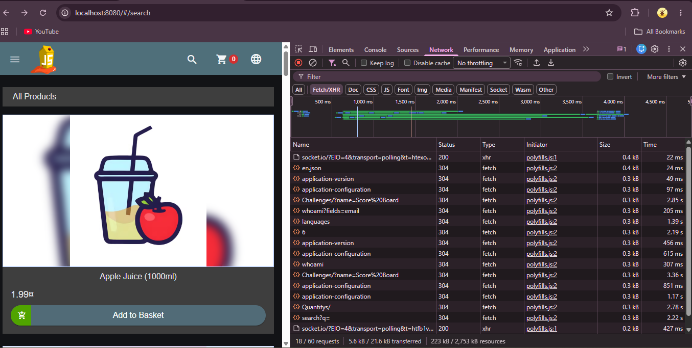
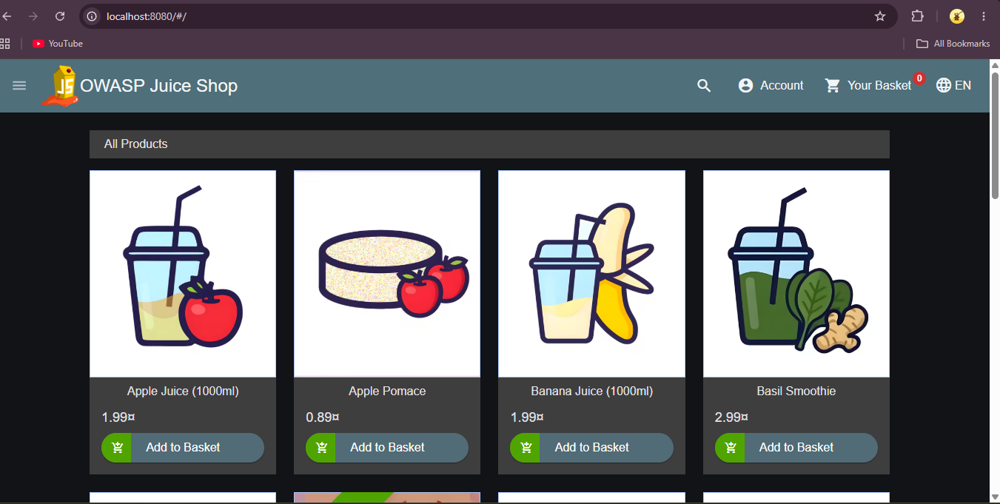
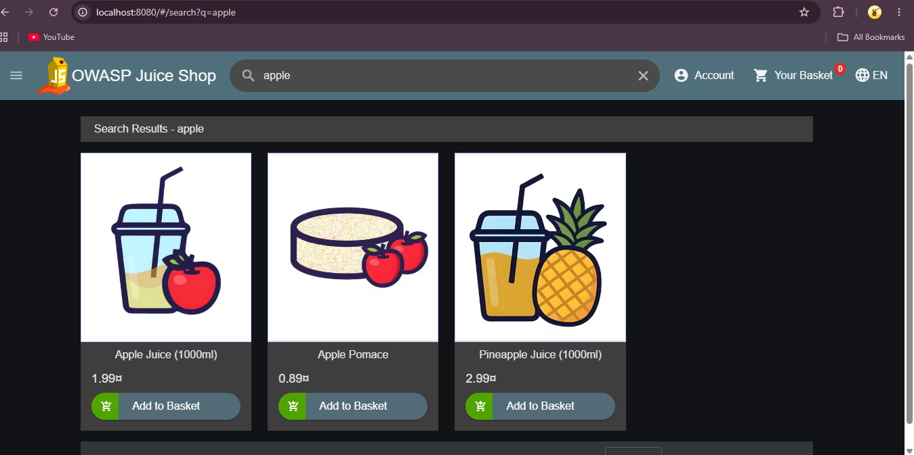
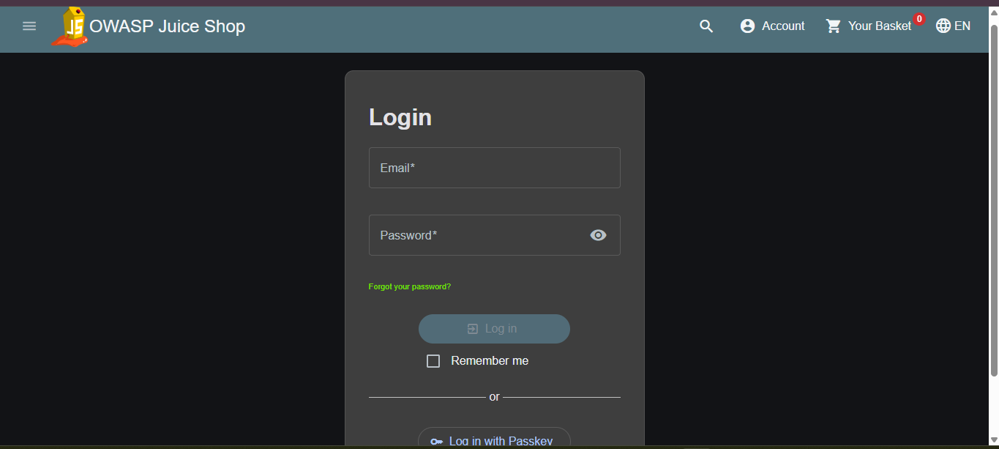
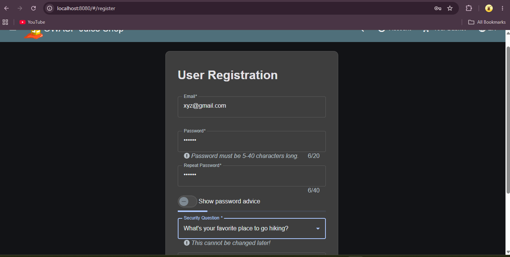
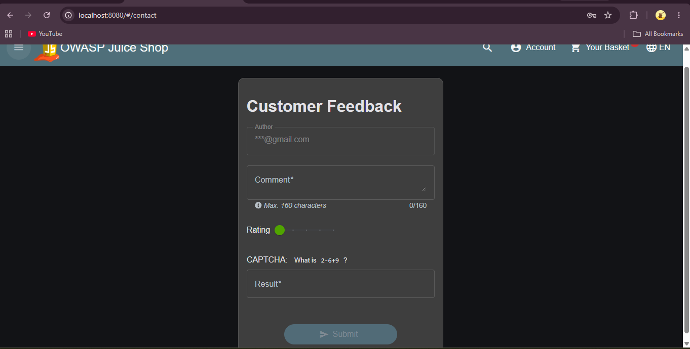

# Attack Surface Map: OWASP Juice Shop

**Target:** OWASP Juice Shop running in an isolated local lab (http://localhost:8080, forwarded to guest port 3000)
**Date:** 24 November 2026
**Scope:** Own lab only, no external targets, synthetic data (see the Scope of Work in the `vuln-lab-scope` repository)
**Method:** Browsed the application and reviewed browser DevTools network requests. Section 2A lists endpoints observed directly in DevTools. Section 2B lists additional endpoints from Juice Shop's standard structure that were not exercised. This is mapping and documentation only; nothing was attacked or exploited.

**Risk key:** **HIGH** = handles credentials, files or untrusted free text, or changes sensitive data. Medium = changes data, stores user input or discloses information. Low = read-only or low impact.

## 1. User Input Fields (Pages)

| # | Page | Input fields | Risk | Why |
|---|---|---|---|---|
| 1 | Login | Email, password, remember me | **HIGH** | Authentication entry point; handles credentials |
| 2 | Registration | Email, password, repeat password, security question, security answer | **HIGH** | Creates accounts and stores credentials and recovery answers |
| 3 | Forgot password | Email, security answer, new password, repeat password | **HIGH** | Account recovery flow can be abused for takeover |
| 4 | Search | Search box | **HIGH** | User text is sent to the backend and shown back on the page |
| 5 | Complaint | Message, file upload | **HIGH** | Accepts a file from the user and free text |
| 6 | Profile | Username, image URL, image file upload | **HIGH** | Accepts a URL and a file; changes account data |
| 7 | Product reviews | Review text | **HIGH** | Free text stored and displayed to other users |
| 8 | Contact / Feedback | Author, comment, rating, CAPTCHA answer | Medium | Free text stored and shown to others; CAPTCHA can be bypassed |
| 9 | Change password | Current, new, repeat password | Medium | Credential change |
| 10 | Basket | Quantity, coupon code, checkout | Medium | Changes server-side basket and prices |
| 11 | Address | Country, name, mobile, ZIP, address, city, state | Medium | Stores personal data |
| 12 | Payment methods | Card name, number, expiry | Medium | Stores payment details (fake data in this lab) |
| 13 | Wallet | Top-up amount | Medium | Changes a balance |
| 14 | Photo wall | Image upload, caption | Medium | File upload and free text |
| 15 | Recycle request | Quantity, address, pickup date | Medium | Creates a record from user input |
| 16 | Data export | Format selection | Medium | Returns the user's stored data |
| 17 | Order tracking | Order ID (URL parameter) | Medium | Object lookup by ID in the URL |
| 18 | Chatbot | Message box | Medium | Free text processed by the server |
| 19 | Language selector | Language dropdown | Low | Changes display language only |
| 20 | Cookie banner and menus | Buttons only | Low | No data entry |

## 2. Endpoints

### 2A. Endpoints observed in DevTools (Network tab, Fetch/XHR filter)

All requests below were captured while browsing the home and search pages. Most returned status 304 (Not Modified), meaning the browser reused a cached copy.

| # | Name in DevTools | Full path | Method | Status | Purpose | Auth needed | Risk | Why |
|---|---|---|---|---|---|---|---|---|
| 1 | `search?q=` | `/rest/products/search?q=` | GET | 304 | Product search | No | **HIGH** | User input passed to the backend and reflected back |
| 2 | `application-configuration` | `/rest/admin/application-configuration` | GET | 304 | Application settings | No | Medium | Information disclosure |
| 3 | `application-version` | `/rest/admin/application-version` | GET | 304 | Application version | No | Medium | Version disclosure helps an attacker |
| 4 | `whoami?fields=email` | `/rest/user/whoami?fields=email` | GET | 304 | Current user details | No (responds while logged out) | Medium | Returns account data and accepts a parameter |
| 5 | `Challenges/?name=Score%20Board` | `/api/Challenges/?name=Score%20Board` | GET | 304 | Challenge data | No | Low | Read-only application data |
| 6 | `Quantitys/` | `/api/Quantitys/` | GET | 304 | Product stock quantities | No | Low | Read-only data |
| 7 | `languages` | `/rest/languages` | GET | 304 | Available languages | No | Low | Read-only |
| 8 | `en.json` | `/assets/i18n/en.json` | GET | 304 | Language text file | No | Low | Static file |
| 9 | `socket.io/?EIO=4&transport=polling` | `/socket.io/?EIO=4&transport=polling` | GET | 200 | Real-time connection | No | Low | Open connection without login |

### 2B. Additional endpoints (standard Juice Shop structure, not exercised)

These endpoints are part of the standard OWASP Juice Shop application. They were not captured in the screenshot above and were not tested.

| # | Method | Endpoint | Purpose | Auth needed | Risk | Why |
|---|---|---|---|---|---|---|
| 1 | POST | `/rest/user/login` | Log in | No | **HIGH** | Credential submission |
| 2 | POST | `/api/Users/` | Register a user | No | **HIGH** | Creates accounts from user input |
| 3 | POST | `/rest/user/reset-password` | Reset password | No | **HIGH** | Account recovery |
| 4 | GET | `/rest/user/security-question?email=` | Fetch a user's security question | No | **HIGH** | Reveals account information by email |
| 5 | POST | `/file-upload` | Complaint file upload | Yes | **HIGH** | Accepts files |
| 6 | POST | `/profile/image/file` | Profile picture upload | Yes | **HIGH** | Accepts files |
| 7 | POST | `/profile/image/url` | Profile picture from a URL | Yes | **HIGH** | Server fetches a user-supplied URL |
| 8 | GET | `/ftp` | Public file directory | No | **HIGH** | Exposed files that should not be public |
| 9 | GET | `/api/Users/` | List users | Varies | **HIGH** | Possible exposure of user data |
| 10 | GET | `/metrics` | Server monitoring data | No | Medium | Information disclosure |
| 11 | GET | `/rest/user/change-password?current=&new=&repeat=` | Change password | Yes | Medium | Credentials sent in a URL |
| 12 | GET | `/rest/basket/{id}` | View a basket | Yes | Medium | Object ID in the URL |
| 13 | POST/PUT | `/api/BasketItems/` | Add or change basket items | Yes | Medium | Changes server-side data |
| 14 | PUT | `/rest/basket/{id}/coupon/{code}` | Apply a coupon | Yes | Medium | User-supplied code changes the price |
| 15 | POST | `/rest/basket/{id}/checkout` | Place an order | Yes | Medium | Order creation |
| 16 | POST | `/api/Feedbacks/` | Submit feedback | No | Medium | Stores user input |
| 17 | GET | `/rest/captcha/` | Fetch a CAPTCHA | No | Low | Supports the feedback form |
| 18 | POST | `/api/Complaints/` | Submit a complaint | Yes | Medium | Stores user input |
| 19 | PUT | `/rest/products/{id}/reviews` | Add a review | Yes | Medium | Stores user input |
| 20 | POST | `/rest/memories` | Photo wall upload | Yes | Medium | File and text upload |
| 21 | POST | `/api/Addresss/` | Save an address | Yes | Medium | Stores personal data |
| 22 | POST | `/api/Cards/` | Save a card | Yes | Medium | Stores payment details |
| 23 | PUT | `/rest/wallet/balance` | Wallet top-up | Yes | Medium | Changes a balance |
| 24 | POST | `/rest/user/data-export` | Export user data | Yes | Medium | Returns stored data |
| 25 | GET | `/rest/track-order/{id}` | Track an order | No | Medium | Object ID in the URL |
| 26 | POST | `/rest/chatbot/respond` | Chatbot reply | Yes | Medium | Free text processed by the server |
| 27 | GET | `/api/Products` | List products | No | Low | Public read-only data |
| 28 | GET | `/api/SecurityQuestions/` | List security questions | No | Low | Supports registration |

## 3. High-Risk Areas and Justifications

1. **Authentication (login, registration, forgot password):** These handle credentials and recovery answers. A weakness here can lead to account takeover, which is why they rank highest.
2. **Search:** The search text goes straight to the backend (observed as `/rest/products/search?q=`) and appears again on the page, so it is a common place for injection and script problems.
3. **File uploads (complaint, profile image, photo wall):** Accepting files from users carries risk if type, size and content are not checked strictly.
4. **URL fetching (profile image URL):** The server requests a URL the user supplies, which can be misused to reach other resources.
5. **Exposed files and information (`/ftp`, `/metrics`, version and configuration endpoints):** Anyone can reach them without logging in, and they reveal internal details. The version and configuration endpoints were observed responding without a login.
6. **Free-text stored input (reviews, feedback, complaints):** Text saved and later shown to other users needs careful handling.

## 4. Screenshots

| Page | File |
|---|---|
| Home | [home.png](images/home.png) |
| Search | [search.png](images/search.png) |
| Login | [login.png](images/login.png) |
| Registration | [register.png](images/register.png) |
| Feedback form | [feedback.png](images/feedback.png) |
| DevTools network requests | [network.png](images/network.png) |

*This is a training exercise on a deliberately vulnerable application in an isolated lab. Nothing outside the lab was accessed.*