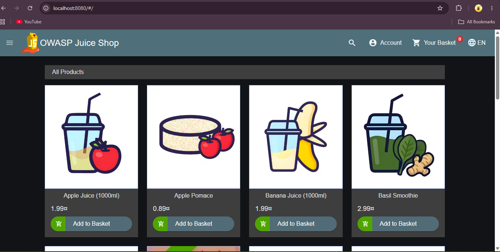
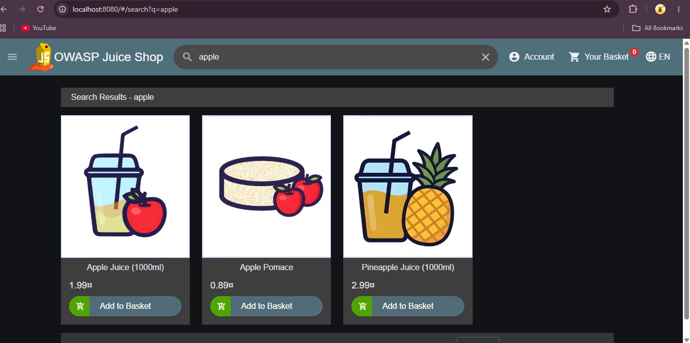
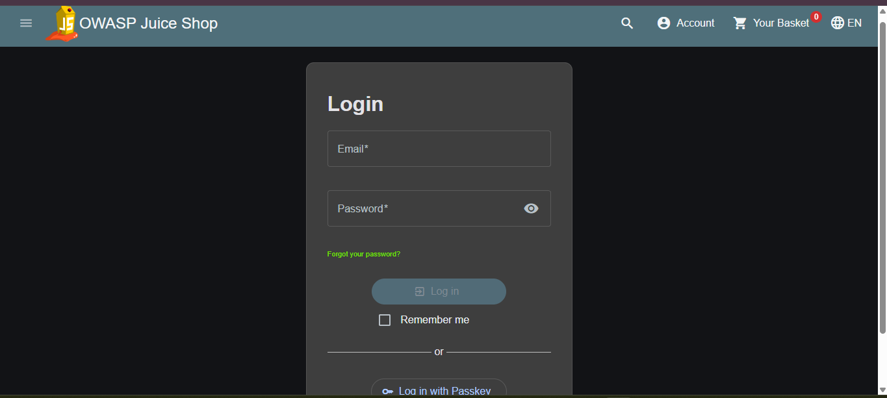
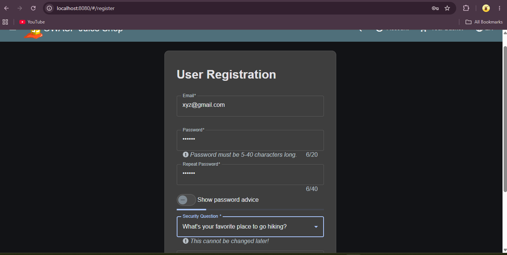
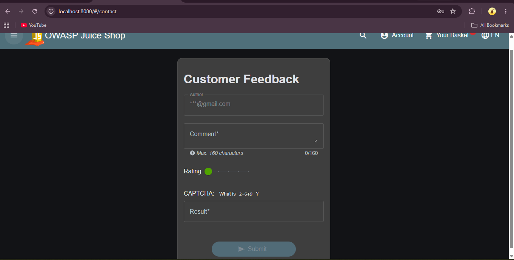
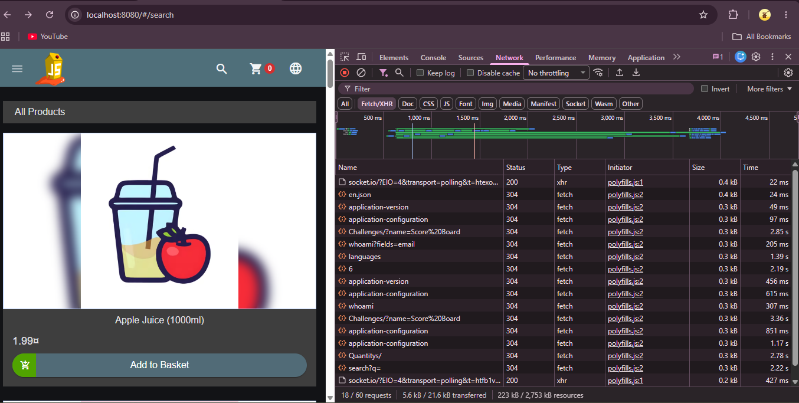

# Juice Shop Attack Surface Map

An attack surface map of OWASP Juice Shop running in an isolated local lab (VirtualBox, Docker, localhost only). It lists input fields, endpoints and high-risk areas, with screenshots of key pages.

## Contents

- [Attack_Surface_Map.md](Attack_Surface_Map.md): input fields, endpoints, risk ratings and justifications
- [images/](images): screenshots of key pages

## Summary

- 20 input areas documented
- 9 endpoints observed directly in browser DevTools
- 28 additional standard Juice Shop endpoints documented (not exercised)
- 37 endpoints in total

## High-Risk Areas

- **Authentication:** login, registration and forgot password handle credentials and recovery answers.
- **Search:** user text goes to the backend and is shown back on the page.
- **File uploads:** complaint, profile image and photo wall accept files.
- **URL fetching:** the profile image URL feature makes the server request a user-supplied address.
- **Exposed information:** `/ftp`, `/metrics`, and the version and configuration endpoints can be reached without logging in.
- **Stored free text:** reviews, feedback and complaints are saved and shown to other users.

## Screenshots

## Method

1. Started the lab VM and the Juice Shop container.
2. Browsed the application at http://localhost:8080 and listed every input field.
3. Reviewed requests in the browser DevTools Network tab to record endpoints.
4. Rated each area by risk and wrote a short justification.
5. Captured screenshots of key pages.

## Scope

Own lab only, no external targets, synthetic data. This project is mapping and documentation only; nothing was attacked or exploited. The lab boundaries are defined in the Scope of Work in the `vuln-lab-scope` repository.